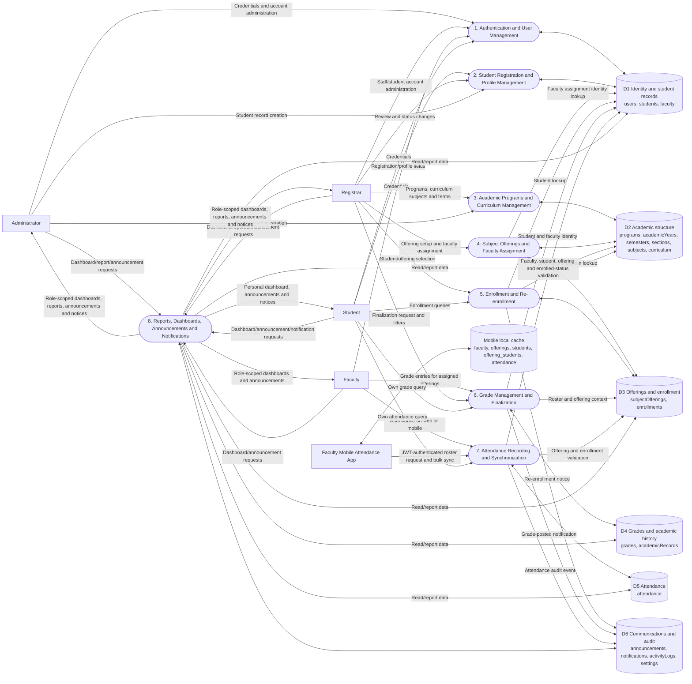

# PIAT School Management System — DFD Level 0

The Level 0 view summarizes only processes found in the backend routes and frontend/mobile clients. Data store labels name the actual central SQLite tables; mobile offline records are separated from central tables.

## Authorization and behavior notes

- Backend JWT middleware applies role restrictions to protected endpoints. User-facing role routes exist under `/dashboard/admin`, `/dashboard/registrar`, `/dashboard/faculty`, and `/dashboard/student`.
- Some read routes are public at the API layer, and several UI routes are not a substitute for backend authorization.
- `/api/students/:studentId/reenroll` currently has no authentication middleware. The registrar page/API client uses it, but the handler does not enforce the caller role or a finalized-grade eligibility rule.
- Registration has a frontend/backend mismatch and auto-approval behavior; see the Level 1 flow and validation report.
- D3 enrollment status is verified as `enrolled` for attendance writes. The faculty roster endpoint itself does not filter out dropped/completed enrollment rows.
- `announcements.subjectId` and `notifications.relatedId` are columns without declared foreign keys. They are not drawn as relational links in the ERD.
