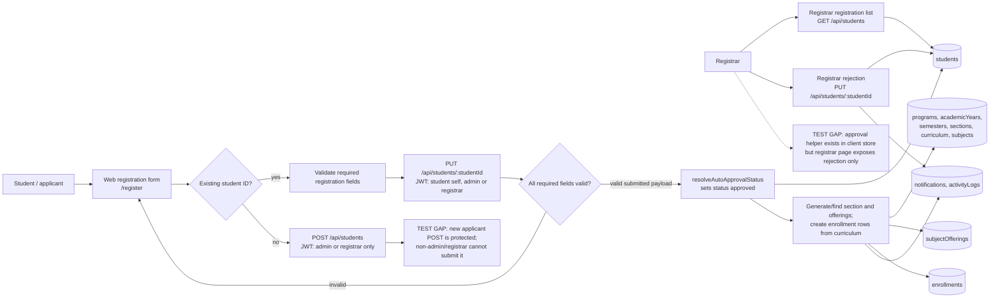
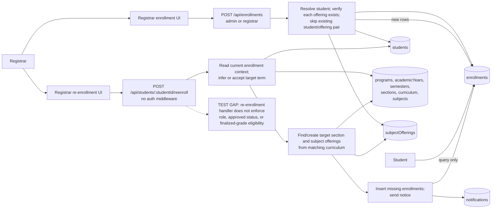
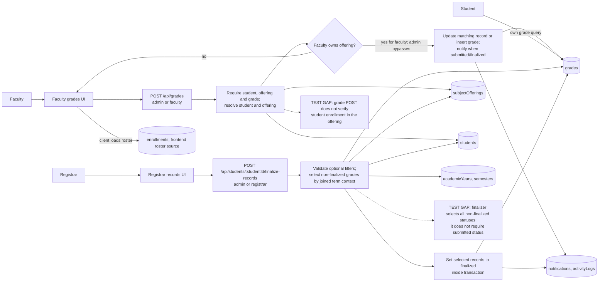

# PIAT School Management System — DFD Level 1

The following decompositions use the implemented routes and datastore writes. Explicit `TEST GAP` labels identify mismatches or behavior not established by the code.

## 1. Student registration and approval



**Observed behavior:** the form sends `status: "submitted"`. The backend requires a set of registration fields; a complete payload resolves directly to `approved` and the student update path invokes auto-enrollment. The standalone create endpoint is restricted to admin/registrar. The registrar screen lists students and implements rejection; the `approveRegistration` store helper was not found wired to that screen. Thus a general pending-then-approve process is not represented as a working path.

## 2. Enrollment and re-enrollment



**Observed behavior:** ordinary enrollment requires an admin/registrar JWT, student ID and a non-empty list of valid offering IDs. Existing student/offering pairs are skipped and the database enforces a unique pair. Re-enrollment uses current enrollment context and curriculum to create/find sections and offerings; the request handler is not role-protected and does not check grade finalization, despite the UI text describing a final-grade eligibility expectation.

## 3. Grade entry and finalization



**Observed behavior:** grade writes are restricted to admin/faculty; faculty are checked against the assigned offering. Required values are checked, but there is no grade range validation or backend enrollment check in this handler. Finalization is restricted to admin/registrar and updates matching non-finalized grades in a transaction. Database checks constrain period/type/status values; the UI's calculated grading components are application behavior.

## 4. Mobile attendance recording and offline synchronization

```mermaid
flowchart LR
  Faculty[Faculty]
  App[Faculty mobile application]
  Login[POST /api/users/login<br/>JWT returned]
  Role{Client confirms faculty role}
  OfferingsGET[GET /api/faculty/offerings<br/>JWT faculty]
  RosterGET[GET /api/faculty/subjects/:id/students<br/>offering ownership check]
  Cache[(Mobile local SQLite<br/>offerings, students,<br/>offering_students)]
  Mark[Choose present, absent, late or excused]
  LocalSave[Save attendance locally<br/>UNIQUE(studentId, offeringId, date)]
  Offline{Internet available?}
  Queue[(Mobile local attendance<br/>syncStatus pending/failed)]
  Bulk[POST /api/attendance/bulk<br/>JWT admin/faculty]
  Validate[Validate required fields, allowed status,<br/>ISO date, student and offering]
  Authorize[Check faculty owns offering;<br/>check enrollment.status = enrolled]
  Duplicate{Central row exists for<br/>student/offering/date?}
  Insert[Insert central attendance row]
  Update[Update existing central row]
  Result[Return created / updated / failed per localId]
  Central[(Central SQLite<br/>attendance)]
  TestGap[TEST GAP: roster endpoint returns all enrollment statuses;<br/>attendance sync rejects non-enrolled rows]
  TestGap2[TEST GAP: no backend/client evidence of<br/>offline login or background sync durability test]

  Faculty --> App --> Login --> Role
  Role -->|faculty| OfferingsGET --> Cache
  Role -->|other role| App
  OfferingsGET --> RosterGET --> Cache
  Cache --> Mark --> LocalSave --> Queue
  LocalSave --> Offline
  Offline -->|no| Queue
  Offline -->|yes / network returns| Bulk
  Queue --> Bulk
  Bulk --> Validate --> Authorize --> Duplicate
  RosterGET -.-> TestGap
  Login -.-> TestGap2
  Duplicate -->|no| Insert --> Central
  Duplicate -->|yes| Update --> Central
  Insert --> Result
  Update --> Result
  Validate -->|invalid| Result
  Authorize -->|unauthorized or not enrolled| Result
  Result --> App --> Faculty
```

**Observed behavior:** login and initial roster/offerings download require the backend. The mobile UI stores attendance locally before synchronization and retries pending/failed records when connectivity is reported. Bulk synchronization identifies the local item with `localId`, but the central backend does not persist that ID; it deduplicates by the central unique key `(studentId, subjectOfferingId, date)` and returns `created`, `updated`, or `failed`. Native builds use SQLite; web builds use in-memory maps. Automatic background/restart durability behavior is not verified beyond the inspected sync initialization code.
