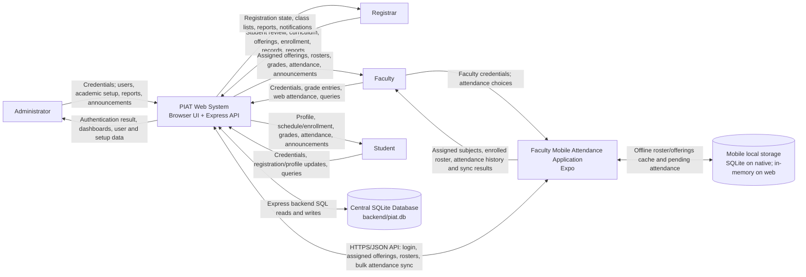

# PIAT School Management System — System Context

This context view distinguishes the browser-based system (web UI and Express API) from the separate Expo faculty attendance application. `backend/piat.db` is the central application database. The mobile app also has an offline local store; that local schema is separate and is not part of the central ERD.

## Verified interaction boundaries

- Browser API calls use the web API client in `src/lib/api.ts`; the backend opens `backend/piat.db` unless `PIAT_DB_PATH` overrides it.
- Mobile login calls `/api/users/login`, accepts only a `faculty` role in the mobile UI, then requests faculty offerings and each offering's student list. A backend connection is required for login and initial roster loading; offline login was not found.
- Mobile attendance can be queued in local SQLite while offline and bulk-posted to `/api/attendance/bulk` when network state reports connectivity.
- The mobile web build substitutes in-memory `Map` stores for local SQLite; persistence across reloads in that build is not implemented by the inspected storage module.
- The central database is opened by `backend/index.js`; initialization enables foreign-key enforcement on that connection. This diagram does not imply that clients connect directly to SQLite.
